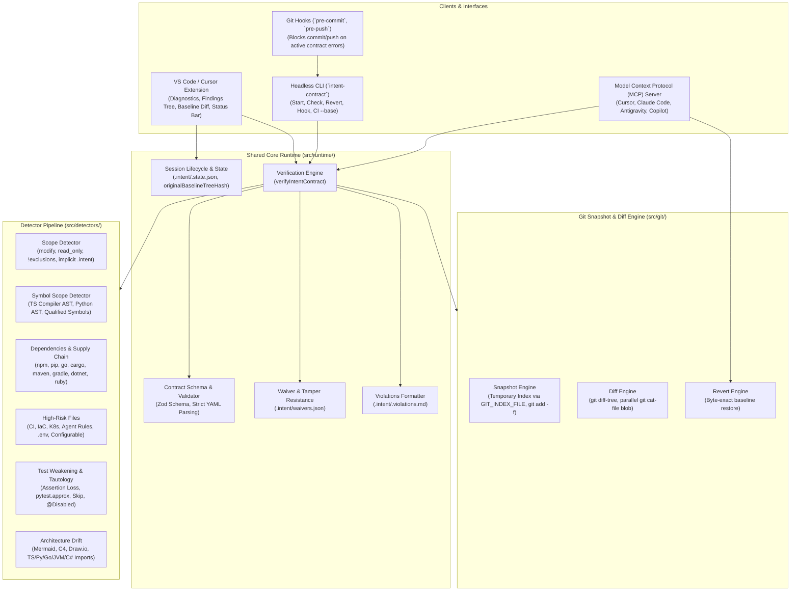
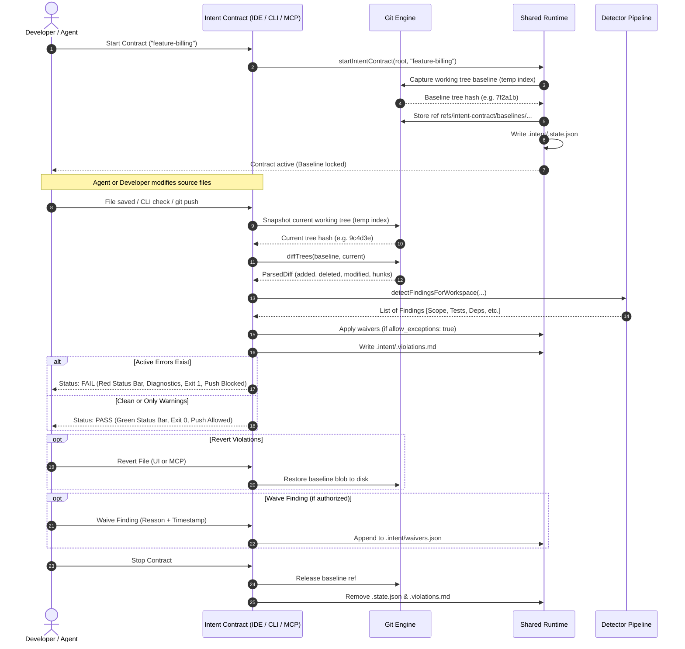

# Intent Contract: Architecture & Deep-Dive Guide

This guide provides an end-to-end architectural reference for **Intent Contract** (`anilkumar4.intent-contract`), detailing how it works, its integration with Git, the detector algorithms, the security model, and the outcomes it delivers.

---

## 1. Executive Summary: What Problem Does Intent Contract Solve?

Autonomous AI coding agents (Claude Code, Cursor, Copilot Workspace, Google Antigravity, Devin, etc.) can write and modify code faster than ever. However, without strict guardrails, agents frequently:
1. **Creep outside their assigned task scope**: Editing unapproved files, touching shared libraries, or modifying configuration.
2. **Silently weaken or bypass test suites**: Relaxing numeric tolerances (`pytest.approx`), deleting assertions, adding `.skip()`, or replacing strict matchers (`toBe` → `toBeTruthy`) to make tests pass.
3. **Introduce supply-chain vulnerabilities**: Adding unvetted runtime dependencies, modifying npm lifecycle scripts (`postinstall`), or adding module replacement directives (`go.mod replace`).
4. **Cause architectural drift**: Introducing unauthorized cross-module imports that violate system design boundaries.
5. **Tamper with guardrails**: Editing the contract itself, loosening read-only rules, or fabricating approval waivers.

**Intent Contract** solves this by establishing an immutable, tamper-resistant **task boundary** backed by Git tree cryptography. It observes file changes, verifies them against a strict policy contract (`.intent/*.yaml`), and reports findings with actionable remediation instructions for humans and AI agents.

---

## 2. Key Benefits & Real-World Outcomes

### Benefits
- **Agent Containment Without Frustration**: Intent Contract does not intercept or block file writes while editing or building. It runs asynchronously, computing findings within milliseconds and surfacing diagnostics instantly.
- **Policy Baseline**: The contract and referenced architecture diagram are loaded from the effective policy baseline, not the dirty working tree. Waivers are read from the separate `.intent/waivers.json` state file and applied only when the baseline contract sets `allow_exceptions: true`.
- **Non-Invasive Git Hygiene**: Baseline snapshots are captured via an isolated temporary Git index. The developer's real Git staging index and untracked files are never touched or modified.
- **Supply Chain & Test Defense**: Detects subtle test weakening across JavaScript, TypeScript, Python, and Go, plus supply-chain risks across npm, pip, Go, Cargo, Maven, Gradle, .NET, and Ruby.
- **Unified Across VS Code, CLI, and MCP**: The exact same detector pipeline powers the VS Code extension, the headless CLI for CI/CD, and the Model Context Protocol (MCP) server for agents.

### Outcomes
| Outcome | Metric / Impact |
| --- | --- |
| **0 Silent Test Weakening** | Catches assertion deletions, matcher downgrades, and tolerance inflation before code is committed. |
| **Zero Scope Creep** | Unapproved file edits and symbol-level mutations are detected with line numbers and remediation instructions. |
| **Gated Delivery (Git Push & Commit Block)** | Git `pre-commit` and `pre-push` hooks prevent broken or out-of-scope code from being committed or pushed. |
| **Deterministic CI Gating** | Returns exit code `1` for active error findings, with GitHub Actions annotations that pinpoint exact lines. |
| **Auditable Exception Trail** | Authorized exceptions require a recorded reason and timestamp bound to the diff hash; future edits to waived code automatically re-open findings. |

---

## 3. High-Level System Architecture

The following diagram illustrates how the VS Code extension, the CLI, and the MCP server interface with the shared Intent Contract runtime, detectors, and the underlying Git repository:



---

## 4. How Intent Contract Works with Git

A core design principle of Intent Contract is **clean, non-invasive Git mechanics**. It acts as a transparent observer without disrupting the user's Git workflow.

### 4.1. Baseline Capture via Temporary Git Index
When a contract is started (`intentContract.start` or `intent-contract start <name>`):
1. **Isolated Index**: The snapshot engine creates an isolated temporary index file via `GIT_INDEX_FILE`. The repository's actual `.git/index` is never read or written.
2. **Working Tree Snapshot**: The temporary index stages the working directory, including untracked and unstaged files (`git add -A`).
3. **Ignored Secret Inclusion**: Canonical secrets such as `.env` and `secrets/**` (which are typically in `.gitignore`) are force-added (`git add -f`) into the temporary index so that changes to existing environment configs are tracked.
4. **Baseline Tree Hash**: `git write-tree` writes a Git tree object representing the baseline, and a reference is saved under `refs/intent-contract/baselines/<id>` so Git's garbage collection does not purge it. Ignored paths matched by `scope.read_only`, plus selected secret and high-risk paths, are force-added to the temporary snapshot so their edits and deletions remain detectable.
5. **Session State**: The state is recorded in `.intent/.state.json` (which is automatically added to `.gitignore`).

### 4.2. Baseline Immutability & Re-baselining Protection
- **Baseline Policy Reading**: When running checks, the active contract (`.intent/<name>.yaml`) and referenced architecture diagrams are read from the effective policy tree using `git cat-file blob`. Newly created sessions use the captured baseline as that policy tree; legacy sessions pin a distinct original policy tree with `originalBaselineRef` so Git garbage collection cannot remove it.
- **Explicit Re-baselining**: A second `start` is rejected while a session is active. The user must stop the current session or pass `--force` to intentionally capture a replacement baseline; old baseline references are released only after the new session has been saved.

### 4.3. Parallelized Diffing with Zero Overhead
When code changes occur:
1. `createWorkingTreeSnapshot(root, scope.read_only)` captures the current working tree into another lightweight temporary tree, including ignored files matched by read-only policy.
2. `diffTrees(root, baselineTreeHash, currentTreeHash)` runs `git diff-tree -r -M -z --name-status` and `git diff -M -U3`.
3. Before and after file contents are read concurrently via `Promise.all` using `git cat-file blob <tree>:<path>`, capping buffer sizes at 2 MB to prevent memory spikes while eliminating serialized process spawn bottlenecks.

### 4.4. Byte-Exact Baseline Reversion
When a file is reverted via the VS Code UI, CLI (`intent-contract revert <file>`), or MCP (`revert_out_of_scope_files`):
- The file is restored **byte-for-byte** to its exact baseline state (including dirty uncommitted work that was present when the contract began).
- If the file was newly added after the baseline was established, it is cleanly removed from disk.
- Path traversal outside the repository is strictly rejected.
- The real Git staging index is untouched.

### 4.5. Git Hooks: Blocking `git commit` and `git push`
Intent Contract can install Git hooks (`intent-contract hook install` or via VS Code **Configure AI Agents & MCP**):
- **`pre-commit`**: Executes `intent-contract check --index`, applying paths staged since the session's starting HEAD to the policy baseline before checking. If any unwaived error-level finding exists, the commit is aborted.
- **`pre-push`**: Verifies each pushed local commit SHA with `intent-contract check --revision <sha>`. If the pushed revision has active contract violations, it prints a prominent error banner to `stderr` and aborts the push:

```
======================================================================
 [Intent Contract] Git push BLOCKED!
 Active contract violations were detected in the pushed revision.
 Resolve error findings or obtain an authorized waiver before pushing.
 Run 'intent-contract check' or inspect VS Code diagnostics for details.
======================================================================
```

---

## 5. Session Lifecycle & Workflow Sequence



---

## 6. Detailed Detector Modules

### 6.1. Path & Symbol Scope (`src/detectors/scope.ts` & `symbolScope.ts`)
- **Path Rules**:
  - `scope.modify`: List of glob patterns permitted to be edited.
  - `scope.read_only`: High-priority read-only paths. Modifying, adding, or deleting a read-only file produces an immediate **error**.
  - **Exclusion Syntax**: `modify: ["src/billing/**", "!src/billing/invoice.ts"]` evaluates exclusions without widening scope to other files.
  - **Implicit Protection**: `.intent/**` (contracts, waivers, state) and diagram files referenced by the contract are implicitly protected as read-only.
- **Symbol-Level Scope**:
  - Restricts changes to specific functions or classes (e.g., `scope.modify_symbols: ["total", "InvoiceBuilder.total"]`).
  - Uses the **TypeScript Compiler API** (`ts.createSourceFile`) to parse ASTs:
    - Function declarations and expressions.
    - Typed and untyped arrow functions: `const f = (x: T): R => {}`.
    - Class methods, getters, setters, and constructors.
    - Top-level constants and declarations outside functions.
  - Supports Python AST parsing (`def`, class methods) and file-qualified symbols (`billing.ts::total`).

### 6.2. Dependency & Supply-Chain Detector (`src/detectors/dependencies.ts`)
- Triggered when `new_dependencies` is in `forbid`.
- Compares `beforeContent` and `afterContent` of manifests to avoid false positives on existing dependencies.
- **Supported Ecosystems**:
  - **npm / yarn / pnpm**: `package.json` (`dependencies`, `devDependencies`, `peerDependencies`, `optionalDependencies`).
  - **Python**: `requirements.txt`, `pyproject.toml` (PEP 621 arrays).
  - **Go**: `go.mod` `require` directives and paired `go.sum` lockfiles.
  - **Rust**: `Cargo.toml`.
  - **Java / Kotlin**: Maven (`pom.xml`) and Gradle (`build.gradle.kts`, `build.gradle`).
  - **.NET**: `*.csproj` (`<PackageReference>`).
  - **Ruby**: `Gemfile`.
- **Supply-Chain Guardrails**:
  - Flags npm lifecycle scripts (`scripts.preinstall`, `scripts.postinstall`).
  - Flags dependency overrides (`overrides` in npm, `resolutions` in yarn).
  - Flags Go module forks (`replace` in `go.mod`).

### 6.3. High-Risk File Detector (`src/detectors/highRisk.ts`)
- Triggered when `high_risk_files` is in `forbid`.
- Checks for modifications or additions to critical infrastructure and control files:
  - **CI/CD**: GitHub Actions (`.github/workflows/**`, `.github/actions/**`, `CODEOWNERS`, `dependabot.yml`), GitLab CI, CircleCI, Azure Pipelines, Jenkinsfile.
  - **Infrastructure as Code**: Terraform (`*.tf`, `*.tfvars`), Bicep (`*.bicep`), Kubernetes manifests (`k8s/**`, `kubernetes/**`), Dockerfiles, Docker Compose.
  - **Agent Rules & Prompts**: `.mcp.json`, `.cursor/**`, `CLAUDE.md`, `AGENTS.md`, `.github/copilot-instructions.md`.
  - **Secrets & Tooling**: `.env*`, `.npmrc`, `.husky/**`, `.vscode/tasks.json`.
- **Contract Customization**: Contracts can extend or relax rules using:
  ```yaml
  high_risk:
    include: ["helm/**", "db/migrations/**"]
    exclude: ["infra/dev.tfvars"]
  ```

### 6.4. Test Weakening & Tautological Tests (`src/detectors/testWeakening.ts`)
- Triggered when `test_weakening` is in `forbid`.
- **Assertion and Test Loss**:
  - Flags net deletion of `expect(...)`, `assert`, or test cases.
  - Flags deleted test files (`*.test.*`, `*.spec.*`, `*_test.go`, `test_*.py`).
- **Matcher Downgrades**:
  - Flags downgrades from strict assertions to truthy assertions (e.g. `.toBe(x)` → `.toBeTruthy()`).
  - Flags assertion negation flips (e.g. `.toBe(x)` → `.not.toBe(x)`).
- **Tolerance Widening**:
  - Flags loosening numeric tolerances in `toBeCloseTo(val, precision)` and `pytest.approx(val, rel=..., abs=...)` (including scientific notation like `1e-6` → `0.5`).
- **Disabled Tests**:
  - Flags `it.skip`, `xit`, `it.todo`, `it.only`, Python `@pytest.mark.skip`, Go `t.Skip()`, and JUnit/Kotest `@Disabled`.
  - Flags test runner config exclusions (`vitest exclude`, `jest testPathIgnorePatterns`).
- **Tautological & Self-Mocking Tests**:
  - Flags tests that assert trivially true conditions (`expect(true).toBe(true)`).
  - Flags tests asserting against their own mock return values.
  - Flags assertion-free tests in JavaScript, TypeScript, and Python.

### 6.5. Architecture Drift (`src/detectors/architectureDrift.ts`)
- Triggered when `architecture_drift` is in `forbid`.
- **Supported Architecture Diagrams**:
  - Mermaid Flowcharts (`.mmd`, fenced markdown, `#anchor` headings).
  - Mermaid C4 diagrams (`Person`, `Container`, `Component`, `Rel`).
  - Draw.io XML and compressed SVG (`.drawio`, `.dio`).
- **Import Resolution**:
  - **TypeScript / JavaScript**: Resolves static, dynamic, require, and `tsconfig` path aliases (`@app/*`).
  - **Python**: Resolves relative imports and *src-layout* package roots.
  - **Go**: Resolves package imports under the module root, including aliased and blank imports (`import _ "..."`).
  - **JVM / .NET**: Resolves Java, C#, and Kotlin namespace packages.
- Cross-node imports that do not have a corresponding directed arrow in the diagram produce an immediate error with exact source line and permitted outgoing connections.

---

## 7. Tamper-Evident Waivers & Policy Integrity

### 7.1. Waiver Integrity
- Waivers live in `.intent/waivers.json`.
- Each waiver record binds to the deterministic finding ID (hash of detector, file, rule, and diff evidence):
  ```json
  {
    "id": "5d75480e6ec686340f9a3cff",
    "reason": "Authorized refactoring of legacy billing interface",
    "timestamp": "2026-10-28T10:00:00.000Z"
  }
  ```
- **Evidence Re-Opening**: If an agent makes further edits to a waived file, the diff evidence changes, recalculating a new finding ID and automatically re-opening the finding.
- **Strict Validation**: Waivers with empty reasons, whitespace, or invalid timestamps are rejected.
- **Schema Gating**: If the contract specifies `allow_exceptions: false`, the runtime ignores all waivers, preventing unauthorized approvals.

---

## 8. CLI Reference & CI/CD Integration

### CLI Commands
```bash
# Start a contract session
intent-contract start <contract-name> [--force]

# Check active contract or verify against a Git ref without a session
intent-contract check [--base <ref>] [--contract <path>] [--index | --revision <sha>] [--format text|json|github]

# Revert a file back to its captured baseline
intent-contract revert <file-path>

# Install Git pre-commit and pre-push hooks
intent-contract hook install

# Stop the active contract session
intent-contract stop
```

### GitHub Actions CI Workflow Example
```yaml
name: Intent Contract Policy Check

on:
  pull_request:
    branches: [main, master]

jobs:
  verify-contract:
    runs-on: ubuntu-latest
    steps:
      - uses: actions/checkout@v4
        with:
          fetch-depth: 0

      - uses: actions/setup-node@v4
        with:
          node-version: 22

      - name: Install Intent Contract
        run: npm install -g anilkumar4/intent-contract-vs-ext

      - name: Verify Contract Against Base Branch
        run: |
          intent-contract check \
            --base origin/${{ github.base_ref }} \
            --contract .intent/default.yaml \
            --format github
```

---

## 9. Summary: Why Intent Contract is Built for Modern AI Engineering

| Feature | Without Intent Contract | With Intent Contract |
| --- | --- | --- |
| **Agent Guardrails** | Rely on system prompts and hope the LLM complies. | Strict Git-level cryptographic enforcement. |
| **Test Quality** | Agents silently delete assertions or skip flaky tests. | Test weakening and assertion loss are flagged instantly. |
| **Architecture** | Codebases drift into spaghetti dependencies over time. | Validated in real-time against visual architecture diagrams. |
| **Git Safety** | Unfinished or out-of-scope work is pushed to remote. | `pre-commit` and `pre-push` hooks block violations at the source. |
| **Remediation** | Manual human review and debugging of diffs. | Structured Markdown remediation ready for one-click prompt injection. |
