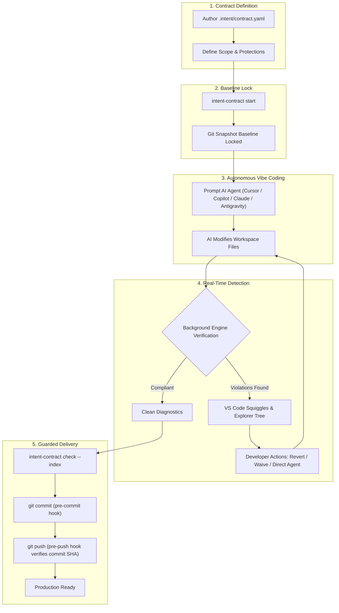

# Intent Contract in the "Vibe Coding" Era: Best Utilization Guide

## Why "Vibe Coding" Needs Intent Contract

In the modern **Vibe Coding** era, developers prompt autonomous AI agents—such as **Cursor**, **Claude Code**, **GitHub Copilot**, and **Google Antigravity**—to build features, refactor components, and write tests at lightspeed. You describe intent in natural language, and the agent writes, modifies, and deletes dozens of files in seconds.

While this drastically boosts development velocity, it introduces critical failure modes that standard linters, TypeScript compilers, and traditional CI pipelines fail to catch:

| Vibe Coding Risk | What AI Agents Frequently Do | How Intent Contract Protects You |
|---|---|---|
| **Silent Scope Creep** | The agent touches files outside the prompt's domain, modifies build configurations, edits shared utilities, or leaks secrets. | Enforces hard boundaries with `scope.modify` and `scope.read_only`. Restricts changes down to specific AST function/method symbols via `scope.modify_symbols`. |
| **Test Weakening ("Faking Green")** | When an edge-case test fails, the agent "fixes" it by changing `.toBe()` to `.toBeTruthy()`, widening numeric bounds, adding `.skip()`, or deleting assertions to report green. | The Test Weakening detector catches net assertion loss, matcher downgrades, `@Disabled`/`t.Skip()`, and tautological tests instantly without running test suites. |
| **Supply-Chain Hallucinations** | The agent hallucinates or imports arbitrary npm, PyPI, or Go packages, adds unauthorized dependencies, or inserts suspicious `postinstall` scripts. | Flags unauthorized dependencies, unpaired lockfile updates, and supply-chain risk scripts across 8 package ecosystems. |
| **Architecture Erosion** | The agent takes shortcuts by importing directly from private internal packages or backend databases instead of domain boundary layers. | Evaluates workspace imports against your Mermaid (`.mmd`) or Draw.io (`.drawio`) architecture diagrams from baseline Git snapshots. |
| **Self-Approval Loopholes** | The agent attempts to bypass constraints by editing the contract file or injecting fake waivers. | Policies are locked in Git's baseline tree object. Changes to `.intent/**` are treated as errors, and waivers are tamper-evident. |
| **Accidental Bad Pushes** | Hallucinated code, unapproved dependencies, or weakened tests get committed and pushed to remote branches before peer review. | The `pre-push` Git hook verifies the exact commit SHA being pushed and aborts the push if active violations exist. |

---

## Lifecycle & Architecture Flow



---

## Step-by-Step Best Practice Workflow

### Step 1: Define Your Contract (`.intent/<feature>.yaml`)

Before prompting your agent, declare the task boundary in `.intent/` (or use the VS Code command `Intent Contract: Create Contract Template`):

```yaml
name: feature-proration
intent: Implement billing proration calculations for subscription upgrades
scope:
  modify:
    - "src/billing/**"
    - "test/billing/**"
  modify_symbols:
    - "prorate"
    - "calculateUpgradeDelta"
  read_only:
    - "src/billing/db.ts"
    - "secrets/**"
forbid:
  - new_dependencies
  - high_risk_files
  - test_weakening
  - architecture_drift
architecture:
  diagram: "docs/system.mmd"
allow_exceptions: true
```

### Step 2: Start the Contract Session

Activate the contract session before prompting your AI assistant:

- **In VS Code**: Open Command Palette (`Ctrl+Shift+P` / `Cmd+Shift+P`) and run:
  `Intent Contract: Start Session` -> select `feature-proration`.
- **In Terminal**:
  ```bash
  intent-contract start feature-proration
  ```

A snapshot of your working directory is captured into an isolated Git tree object (`GIT_INDEX_FILE`). This snapshot is your baseline. The contract is locked in.

### Step 3: Configure Your AI Agent

Intent Contract can automatically inject contract boundaries into your AI toolchain so the agent is aware of allowed scopes:

- **VS Code Command**: `Intent Contract: Export Agent Configuration`
- **Supported Environments**:
  - **Cursor**: Generates `.cursorrules` or `.cursor/rules/intent-contract.mdc`.
  - **Claude Code**: Updates `CLAUDE.md`.
  - **GitHub Copilot**: Writes `.github/copilot-instructions.md`.
  - **Google Antigravity / Gemini**: Writes `.gemini/rules/AGENTS.md` and custom skills.
  - **Model Context Protocol (MCP)**: Runs a persistent JSON-RPC stdio server (`mcp-server.js`) exposing tools:
    - `check_contract`: Check current workspace violations.
    - `get_active_contract`: Read locked contract rules and allowed symbols.
    - `list_violations`: List categorized violation summaries.
    - `explain_violation`: Get fix recommendations for a specific finding.
  - **Git Hooks**:
    ```bash
    intent-contract install-hooks
    ```
    Installs `.git/hooks/pre-commit` and `.git/hooks/pre-push` to guard your repository boundaries automatically.

### Step 4: Vibe Code Freely

Prompt your agent as usual:

> *"Implement subscription upgrade proration in src/billing/proration.ts with 100% test coverage for partial-month calculations."*

The agent writes code, creates files, and runs tests.

### Step 5: Real-Time Non-Blocking Triage

Intent Contract runs non-blocking verification on every keystroke and save (~600–900 ms latency):

1. **Problems Panel & In-Editor Squiggles**:
   Violations appear as diagnostics at exact lines and columns. For example:
   - `[symbol_scope/symbol_not_allowed] Changed symbol "ratio" is not listed in scope.modify_symbols`
   - `[test_weakening/assertion_loss] Net assertion count dropped by 2`
   - `[dependencies/unauthorized_dependency] Package "axios" added to package.json is forbidden`
2. **Explorer Tree View**:
   The **Intent Contract** sidebar panel shows live violation counts categorized by detector.
3. **Context Actions**:
   - **Diff with Baseline**: Right-click any file in the Explorer or Tree View to open a side-by-side diff comparing the working file against the baseline Git tree snapshot.
   - **Revert File to Baseline**: Instantly roll back agent hallucinations or unwanted file edits without touching git history.
   - **Add Waiver**: For intentional exceptions, record a tamper-evident waiver with an audit reason (only when `allow_exceptions: true`).

### Step 6: Safe Stage, Commit, and Push

When your task is complete:

```bash
# 1. Verify candidate changes staged in Git index
intent-contract check --index

# 2. Stage and commit
git add src/billing/proration.ts test/billing/proration.test.ts
git commit -m "feat(billing): implement subscription proration"

# 3. Push to remote (guarded by pre-push hook)
git push origin feature/proration
```

If an agent quietly weakened an existing test or touched a forbidden configuration file, `pre-push` aborts the push before the code leaves your machine:

```text
Intent Contract check failed on commit a1b2c3d:
  error src/config/app.json [path_scope/read_only_modified] File is marked read-only in active contract
Push aborted by pre-push hook.
```

### Step 7: Conclude Session

Once verified and committed:

- **In VS Code**: Run `Intent Contract: Stop Session`.
- **In Terminal**:
  ```bash
  intent-contract stop
  ```

---

## Key Detectors Protecting Vibe Coders

| Detector | What It Inspects | Why It Matters for AI Coding |
|---|---|---|
| **Path Scope** | `scope.modify`, `scope.read_only`, `.gitignore` | Prevents agents from touching shared configuration, CI/CD workflows, or unrelated feature domains. |
| **Symbol Scope** | AST parser for TypeScript, JavaScript, Python, Go | Restricts modifications down to specific functions or classes. Changes inside allowed functions (local variables, inner loops) are permitted; modifications to other symbols produce errors. |
| **Test Weakening** | AST comparison of test files (Jest, Vitest, Mocha, PyTest, Go `testing`) | Prevents agents from "faking green" by deleting assertions, downgrading `.toBe()` to `.toBeTruthy()`, skipping tests (`it.skip`), or writing tautological assertions (`expect(true).toBe(true)`). |
| **Dependency Guard** | `package.json`, `requirements.txt`, `go.mod`, `Cargo.toml`, etc. | Flags hallucinated package installations and detects missing lockfile synchronizations across 8 major package ecosystems. |
| **High-Risk Files** | Cryptographic keys, secrets, `.env`, workflows, root configurations | Stops agents from inadvertently committing secrets or altering deployment manifests. |
| **Architecture Drift** | Mermaid (`.mmd`) and Draw.io (`.drawio`) diagrams | Parses architectural directional dependencies and flags prohibited cross-boundary imports. |
| **Policy Integrity** | Baseline `.intent/**` tree objects | Prevents agents from self-approving by tampering with the contract or injecting unauthorized waivers. |

---

## Agent Integration Recipes

### 1. Cursor Setup
Run `Intent Contract: Export Agent Configuration` -> Select **Cursor**.
This generates `.cursor/rules/intent-contract.mdc` instructing Cursor's agent to consult the contract rules before every tool invocation.

### 2. Google Antigravity & Gemini Setup
Select **Antigravity** from the export command to place contract instructions into `.gemini/rules/AGENTS.md`. Antigravity agents automatically prioritize these rules and use MCP tools to self-verify.

### 3. Claude Code Setup
Run `intent-contract export-rules claude` to update `CLAUDE.md`. Claude Code will automatically run `intent-contract check` before presenting completed code.

### 4. GitHub Copilot Setup
Select **Copilot** to generate `.github/copilot-instructions.md`. Copilot Chat and agent workspaces will enforce task constraints during code generation.

---

## Command Quick Reference

| Command / CLI | Action |
|---|---|
| `intent-contract start <contract>` | Capture baseline Git tree snapshot and begin contract session. |
| `intent-contract check` | Run all detectors against current working copy. |
| `intent-contract check --index` | Verify candidate tree staged in Git index (`pre-commit`). |
| `intent-contract check --revision <sha>` | Verify exact commit object being pushed (`pre-push`). |
| `intent-contract stop` | Stop active session and clear baseline snapshot reference. |
| `intent-contract status` | Show active contract details and current violation count. |
| `intent-contract diff <file>` | Open terminal diff of working file against baseline snapshot. |
| `intent-contract revert <file>` | Revert workspace file back to baseline snapshot. |
| `intent-contract waive <violation-id>` | Add a documented exception waiver to `.intent/waivers.json`. |
| `intent-contract install-hooks` | Install `.git/hooks/pre-commit` and `pre-push` verification hooks. |
| `intent-contract export-rules <agent>` | Export prompt rules for Cursor, Claude, Copilot, or Antigravity. |

