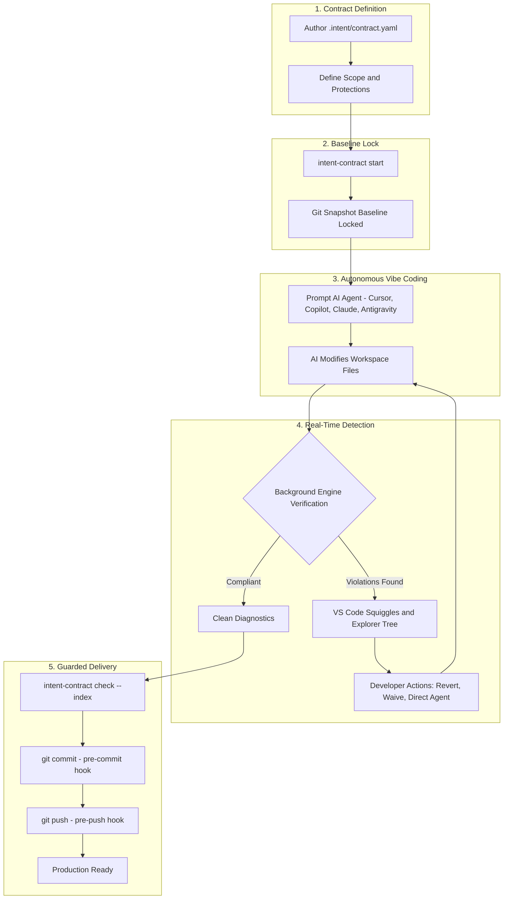

# Intent Contract in the "Vibe Coding" Era: Best Utilization Guide

## Why "Vibe Coding" Needs Intent Contract

In the modern **Vibe Coding** era, developers prompt autonomous AI agents—such as **Cursor**, **Claude Code**, **GitHub Copilot**, and **Google Antigravity**—to build features, refactor components, and write tests at lightspeed. You describe intent in natural language, and the agent writes, modifies, and deletes dozens of files in seconds.

While this drastically boosts development velocity, it introduces critical failure modes that standard linters, TypeScript compilers, and traditional CI pipelines fail to catch:

| Vibe Coding Risk | What AI Agents Frequently Do | How Intent Contract Protects You |
|---|---|---|
| **Silent Scope Creep** | The agent touches files outside the prompt's domain, modifies build configurations, edits shared utilities, or leaks secrets. | Enforces hard boundaries with `scope.modify` and `scope.read_only`. Restricts changes down to specific AST function/method symbols via `scope.modify_symbols`. |
| **Test Weakening ("Faking Green")** | When an edge-case test fails, the agent "fixes" it by changing `.toBe()` to `.toBeTruthy()`, widening numeric bounds, adding `.skip()`, or deleting assertions to report green. | The Test Weakening detector catches net assertion loss, matcher downgrades, `@Disabled`/`t.Skip()`, and tautological tests instantly without running test suites. |
| **Supply-Chain Hallucinations** | The agent hallucinates or imports arbitrary npm, PyPI, or Go packages, adds unauthorized dependencies, or inserts suspicious `postinstall` scripts. | Flags unauthorized dependencies, unpaired lockfile updates, and supply-chain risk scripts across 8 package ecosystems. |
| **Architecture Erosion** | The agent takes shortcuts by importing directly from private internal packages or backend databases instead of domain boundary layers. | Evaluates workspace imports against your Mermaid (`.mmd`) or Draw.io (`.drawio`) architecture diagrams from baseline Git snapshots. |
| **Self-Approval Loopholes** | The agent attempts to bypass constraints by editing the contract file or injecting fake waivers. | Policies are locked in Git's baseline tree object. Changes to `.intent/**` are treated as errors, and waivers are tamper-evident. |
| **Accidental Bad Pushes** | Hallucinated code, unapproved dependencies, or weakened tests get committed and pushed to remote branches before peer review. | The `pre-push` Git hook verifies the exact commit SHA being pushed and aborts the push if active violations exist. |

---

## Lifecycle & Architecture Flow



---

## Step-by-Step Best Practice Workflow

### Step 1: Define Your Contract (`.intent/<feature>.yaml`)

Before prompting your agent, declare the task boundary in `.intent/` using raw YAML, the **Visual Contract Builder** (`Intent Contract: Visual Contract Builder`), or the template wizard (`Intent Contract: Create Contract From Template`):

```yaml
name: feature-proration
intent: Implement billing proration calculations for subscription upgrades
scope:
  modify:
    - "src/billing/**"
    - "test/billing/**"
  modify_symbols:
    - "prorate"
    - "calculateUpgradeDelta"
  read_only:
    - "src/billing/db.ts"
    - "secrets/**"
forbid:
  - new_dependencies
  - high_risk_files
  - test_weakening
  - architecture_drift
architecture:
  diagram: "docs/system.mmd"
allow_exceptions: true
```

### Step 2: Start the Contract Session

Activate the contract session before prompting your AI assistant:

- **In VS Code**: Open Command Palette (`Ctrl+Shift+P` / `Cmd+Shift+P`) and run `Intent Contract: Start Contract`, or click **Start Contract** in the dedicated Activity Bar sidebar.
- **In Terminal**:
  ```bash
  intent-contract start feature-proration
  ```

A snapshot of your working directory is captured into an isolated Git tree object (`GIT_INDEX_FILE`). This snapshot is your baseline. The contract is locked in.

### Step 3: Configure Your AI Agent & Dynamic Hot-Sync

Intent Contract can automatically inject contract boundaries into your AI toolchain so the agent is aware of allowed scopes:

- **VS Code Command**: `Intent Contract: Configure AI Agents & MCP`
- **Supported Environments**:
  - **Cursor**: Generates `.cursor/rules/intent-contract.mdc` and configures `.cursor/mcp.json`.
  - **Claude Code**: Updates `CLAUDE.md` and `.mcp.json`.
  - **GitHub Copilot**: Writes `.github/copilot-instructions.md` and `.vscode/mcp.json`.
  - **Google Antigravity**: Configures `.agents/rules/intent-contract.md` and `.agents/mcp_config.json`.
  - **Dynamic Agent Prompt Hot-Sync**: Automatically injects active contract constraints into Cursor, Claude Code, GitHub Copilot, and Google Antigravity instruction files during active sessions and clears them cleanly on session termination.
  - **Model Context Protocol (MCP 2.0)**: Persistent JSON-RPC stdio server (`mcp-server.js`) exposing autonomous agent tools:
    - `get_active_contract`: Read locked contract rules and allowed symbols.
    - `verify_intent_contract`: Run complete verification with findings and structured remediation text.
    - `get_remediation_instructions`: Return step-by-step actionable instructions for agent self-correction.
    - `revert_out_of_scope_files`: Restore scope-violating files to baseline.
    - `self_heal_contract`: Autonomous agent loop that reverts out-of-scope files and re-verifies workspace.
    - `start_intent_contract`: Start a named contract session.
  - **Git Hooks**:
    ```bash
    intent-contract hook install
    ```
    Installs `.git/hooks/pre-commit` and `.git/hooks/pre-push` to guard your repository boundaries automatically.

### Step 4: Vibe Code Freely

Prompt your agent as usual:

> *"Implement subscription upgrade proration in src/billing/proration.ts with 100% test coverage for partial-month calculations."*

The agent writes code, creates files, and runs tests.

### Step 5: Real-Time Non-Blocking Triage & Observability

Intent Contract runs non-blocking verification on every keystroke and save (~600–900 ms latency):

1. **Mission Control Dashboard**:
   Open `Intent Contract: Open Mission Control Dashboard` for live radar scorecards across Scope Adherence, Test Fidelity, Dependencies, and Architecture Drift, with 1-click corrective prompt generation, out-of-scope reverts, and compliance report exporting.
2. **Visual Architecture Drift Inspector**:
   Open `Intent Contract: View Architecture Drift Inspector` to view an interactive Mermaid diagram overlay with green allowed edges, red dashed cross-import violation arrows, violation table, and 1-click **📍 Jump to Line** and **⏪ Revert** buttons.
3. **Ambient CodeLens**:
   Shows non-intrusive status indicators at line 1 of active files (`🛡️ Intent: In-Scope`, `🔒 Intent: Read-Only`, `⚠️ Intent: Out of Scope`) with 1-click actions.
4. **Interactive Quick-Fix CodeActions**:
   Hover over squiggles or press `Ctrl+.` / `Cmd+.` (💡) on diagnostics to instantly add files to scope, revert changes back to baseline, or whitelist functions in `scope.modify_symbols`.
5. **Interactive Status Bar HUD**:
   Click the `$(shield)` item in the status bar to launch a command HUD for quick session controls, dashboard navigation, reports, and contract switching.
6. **Session Compliance Reports**:
   Run `Intent Contract: Export Session Compliance Report` to generate verified Markdown AI Safety certificates in `.intent/reports/compliance-report-<timestamp>.md` with a 5-dimension scorecard, modified files ledger, and cryptographic Git audit seal.
7. **Problems Panel & In-Editor Squiggles**:
   Violations appear as diagnostics at exact lines and columns. For example:
   - `[symbol_scope/symbol_not_allowed] Changed symbol "ratio" is not listed in scope.modify_symbols`
   - `[test_weakening/assertion_loss] Net assertion count dropped by 2`
   - `[dependencies/unauthorized_dependency] Package "axios" added to package.json is forbidden`
8. **Activity Bar Panel & In-Editor Scope Helpers**:
   The **Intent Contract** sidebar panel shows live violation counts categorized by detector. Right-click any file or symbol in the editor to add them to scope or mark them as read-only with dynamic baseline synchronization.
9. **Smart Waiver Justification Templates**:
   For intentional exceptions, choose from smart justification templates (`Authorized refactoring`, `Approved scope extension`, `Approved dependency update`, `Architectural boundary exception`) with custom fallback (only when `allow_exceptions: true`).

### Step 6: Safe Stage, Commit, and Push

When your task is complete:

```bash
# 1. Verify candidate changes staged in Git index
intent-contract check --index

# 2. Stage and commit
git add src/billing/proration.ts test/billing/proration.test.ts
git commit -m "feat(billing): implement subscription proration"

# 3. Push to remote (guarded by pre-push hook)
git push origin feature/proration
```

If an agent quietly weakened an existing test or touched a forbidden configuration file, `pre-push` aborts the push before the code leaves your machine:

```text
Intent Contract check failed on commit a1b2c3d:
  error src/config/app.json [path_scope/read_only_modified] File is marked read-only in active contract
Push aborted by pre-push hook.
```

### Step 7: Conclude Session

Once verified and committed:

- **In VS Code**: Run `Intent Contract: Stop Session`.
- **In Terminal**:
  ```bash
  intent-contract stop
  ```

---

## Key Detectors Protecting Vibe Coders

| Detector | What It Inspects | Why It Matters for AI Coding |
|---|---|---|
| **Path Scope** | `scope.modify`, `scope.read_only`, `.gitignore` | Prevents agents from touching shared configuration, CI/CD workflows, or unrelated feature domains. |
| **Symbol Scope** | AST parser for TypeScript, JavaScript, Python, Go | Restricts modifications down to specific functions or classes. Changes inside allowed functions (local variables, inner loops) are permitted; modifications to other symbols produce errors. |
| **Test Weakening** | AST comparison of test files (Jest, Vitest, Mocha, PyTest, Go `testing`) | Prevents agents from "faking green" by deleting assertions, downgrading `.toBe()` to `.toBeTruthy()`, skipping tests (`it.skip`), or writing tautological assertions (`expect(true).toBe(true)`). |
| **Dependency Guard** | `package.json`, `requirements.txt`, `go.mod`, `Cargo.toml`, etc. | Flags hallucinated package installations and detects missing lockfile synchronizations across 8 major package ecosystems. |
| **High-Risk Files** | Cryptographic keys, secrets, `.env`, workflows, root configurations | Stops agents from inadvertently committing secrets or altering deployment manifests. |
| **Architecture Drift** | Mermaid (`.mmd`) and Draw.io (`.drawio`) diagrams | Parses architectural directional dependencies and flags prohibited cross-boundary imports. |
| **Policy Integrity** | Baseline `.intent/**` tree objects | Prevents agents from self-approving by tampering with the contract or injecting unauthorized waivers. |

---

## Agent Integration Recipes

### 1. Cursor Setup
Run `Intent Contract: Configure AI Agents & MCP` -> Select **Cursor**.
This generates `.cursor/rules/intent-contract.mdc` and `.cursor/mcp.json` instructing Cursor's agent to consult contract rules and use MCP tools for verification and self-healing.

### 2. Google Antigravity & Gemini Setup
Select **Antigravity** from the configuration command to place contract instructions into `.agents/rules/intent-contract.md` and configure `.agents/mcp_config.json`. Antigravity agents automatically prioritize these rules and use MCP tools to self-verify.

### 3. Claude Code Setup
Select **Claude Code** from the configuration command to update `CLAUDE.md` and `.mcp.json`. Claude Code will automatically run `intent-contract check` before presenting completed code.

### 4. GitHub Copilot Setup
Select **Copilot** to generate `.github/copilot-instructions.md` and `.vscode/mcp.json`. Copilot Chat and agent workspaces will enforce task constraints during code generation.

---

## Command Quick Reference

### Headless CLI Commands
| CLI Command | Action |
|---|---|
| `intent-contract start <contract> [--force]` | Capture baseline Git tree snapshot and begin contract session. |
| `intent-contract check [--base <ref>] [--contract <path>] [--format text\|json\|github]` | Run all detectors against current working copy or Git reference. |
| `intent-contract check --index` | Verify candidate tree staged in Git index (`pre-commit`). |
| `intent-contract check --revision <sha>` | Verify exact commit object being pushed (`pre-push`). |
| `intent-contract report [--output <path>]` | Generate compliance report; appends to `$GITHUB_STEP_SUMMARY` in CI. |
| `intent-contract revert <file>` | Revert workspace file back to baseline snapshot. |
| `intent-contract hook install` | Install `.git/hooks/pre-commit` and `pre-push` verification hooks. |
| `intent-contract guide` | Print summary and link to this Vibe Coding Guide. |
| `intent-contract stop` | Stop active session and clear baseline snapshot reference. |

### VS Code UI Commands
| VS Code Command | Action |
|---|---|
| `Intent Contract: Open Mission Control Dashboard` | Launch real-time visual health scorecards, 1-click agent prompt, and report exports. |
| `Intent Contract: View Architecture Drift Inspector` | Visual Mermaid diagram with green allowed edges, red dashed violations, and jump-to-line. |
| `Intent Contract: Visual Contract Builder` | Form wizard to visually define file scopes, symbols, policies, and diagrams without YAML. |
| `Intent Contract: Export Session Compliance Report` | Export verified Markdown AI Safety Certificate in `.intent/reports/`. |
| `Intent Contract: Configure AI Agents & MCP` | Configure Cursor, Antigravity, Claude Code, Copilot, and Git hooks. |
| `Intent Contract: Add Symbol to Active Scope` | Editor context menu action to append current function to `scope.modify_symbols`. |
| `Intent Contract: Add File to Active Scope (Modify)` | Context action to append active file to `scope.modify`. |
| `Intent Contract: Mark File as Read-Only` | Context action to append active file to `scope.read_only`. |
| `Intent Contract: Getting Started Walkthrough` | Native 5-step visual onboarding walkthrough. |

