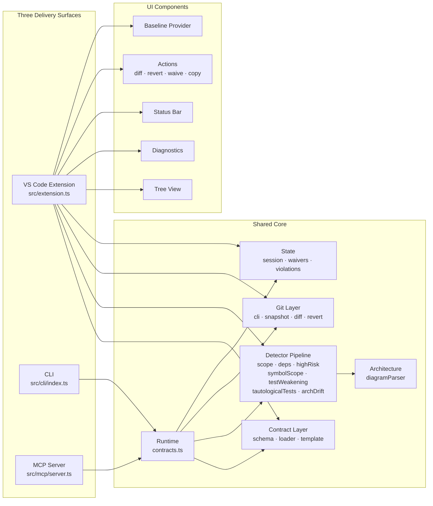
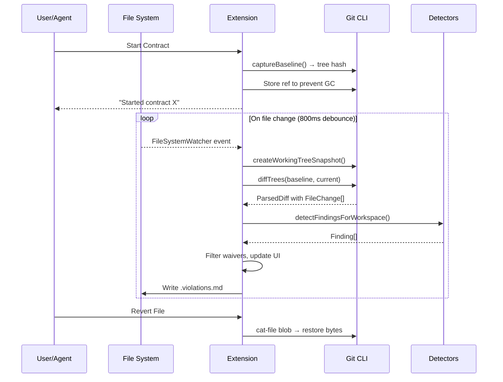

# Intent Contract — Complete Project Analysis

## Executive Summary

**Intent Contract** is a VS Code extension (+ CLI + MCP server) that acts as a **policy enforcement guardrail for AI-assisted coding**. It captures a Git working tree as a frozen baseline, then continuously detects when file changes violate a YAML-defined "contract" — scope boundaries, forbidden dependency additions, high-risk file edits, test weakening, and architectural drift. It reports violations *after* writes (non-blocking), provides one-click revert to baseline, and feeds structured remediation instructions to AI agents so they can self-correct.

> [!IMPORTANT]
> The key design philosophy: **a code change cannot approve itself**. The contract and architecture diagram are always read from the captured baseline tree, not the working copy, so an AI agent can't weaken its own rules.

---

## Architecture Overview



---

## Module-by-Module Breakdown

### 1. Contract Layer — `src/contract/`

| File | Purpose |
|------|---------|
| [`schema.ts`](file:///c:/Users/ANIL/Downloads/Codex-Play/Intent-Contract-VS-EXT/src/contract/schema.ts) | **Zod schema** defining the contract shape: `name`, `intent`, `scope` (modify/read_only/modify_symbols), `architecture` (diagram/node_mappings/deny_unlisted_edges), `forbid` enum array, `allow_exceptions`. Custom refinement enforces that `architecture_drift` in `forbid` requires an `architecture` block. |
| [`loader.ts`](file:///c:/Users/ANIL/Downloads/Codex-Play/Intent-Contract-VS-EXT/src/contract/loader.ts) | Discovers `.intent/*.yaml` files, reads and parses YAML, validates against the Zod schema. `parseContract()` is also used to parse contracts from Git blob buffers. |
| [`template.ts`](file:///c:/Users/ANIL/Downloads/Codex-Play/Intent-Contract-VS-EXT/src/contract/template.ts) | Creates a default `default.yaml` template and ensures `.intent/.gitignore` ignores transient metadata files (`.state.json`, `.violations.md`, `waivers.json`, `.architecture-drift.mmd`). |

### 2. Detector Pipeline — `src/detectors/`

The heart of the system. Seven independent detectors run in a pipeline, each returning `Finding[]`:

| Detector | File | What It Catches | Severity |
|----------|------|-----------------|----------|
| **Scope** | [`scope.ts`](file:///c:/Users/ANIL/Downloads/Codex-Play/Intent-Contract-VS-EXT/src/detectors/scope.ts) | Files outside `scope.modify` (warning) or in `scope.read_only` (error) | error/warning |
| **Symbol Scope** | [`symbolScope.ts`](file:///c:/Users/ANIL/Downloads/Codex-Play/Intent-Contract-VS-EXT/src/detectors/symbolScope.ts) | Changes to function/variable symbols *not* in `scope.modify_symbols`. Uses a lightweight JS/Python parser that masks comments/strings, then matches diff lines to symbol ranges. | error |
| **Dependencies** | [`dependencies.ts`](file:///c:/Users/ANIL/Downloads/Codex-Play/Intent-Contract-VS-EXT/src/detectors/dependencies.ts) | New dependencies or version changes in `package.json`, `pyproject.toml`, `Pipfile`, `go.mod`, `Cargo.toml`, `requirements*.txt`. Also detects unpaired lockfile changes. Full before/after manifest diffing. | error/warning |
| **High Risk Files** | [`highRisk.ts`](file:///c:/Users/ANIL/Downloads/Codex-Play/Intent-Contract-VS-EXT/src/detectors/highRisk.ts) | Changes to CI workflows, `.env`, Dockerfiles, Terraform, agent config, lockfiles | error |
| **Test Weakening** | [`testWeakening.ts`](file:///c:/Users/ANIL/Downloads/Codex-Play/Intent-Contract-VS-EXT/src/detectors/testWeakening.ts) | **The most sophisticated detector** (~900 lines). Implements a full tokenizer and assertion parser for JS/Python. Detects: deleted test files, snapshot deletions, net test block loss, net assertion loss, disabled tests (`.skip`, `.only`, `pytest.mark.skip`, etc.), trivially-true assertions, matcher downgrades (Tier 1→2→3), assertion negation flips, tolerance widening (`toBeCloseTo` precision / `pytest.approx` rel), expected value changes coinciding with implementation changes, inline snapshot changes, empty test blocks. | error/warning |
| **Tautological Tests** | [`tautologicalTests.ts`](file:///c:/Users/ANIL/Downloads/Codex-Play/Intent-Contract-VS-EXT/src/detectors/tautologicalTests.ts) | Assertion-free test blocks and self-mocking (asserting a value returned by a mock you configured in the same test) | error |
| **Architecture Drift** | [`architectureDrift.ts`](file:///c:/Users/ANIL/Downloads/Codex-Play/Intent-Contract-VS-EXT/src/detectors/architectureDrift.ts) | Import statements in changed files that violate the architecture diagram's directed dependency graph. Supports JS/TS (via TypeScript compiler API resolution), Python, and Go imports. Diagram is read from the *baseline* tree. | error/warning |

**Finding identity**: Each finding gets a SHA-256-based `id` derived from `[detector, file, rule, evidence]`, making it deterministic and waivable.

### 3. Architecture Diagram Parser — `src/architecture/diagramParser.ts`

| Format | Support |
|--------|---------|
| **Mermaid** `.mmd` | `flowchart`/`graph` with all arrow types (`-->`, `-.->`, `==>`, bidirectional `<-->`) and C4 (`Container`, `Rel`, `BiRel`) |
| **Markdown** `.md#anchor` | Finds fenced `mermaid` code blocks, optionally scoped to a `#heading` anchor |
| **Draw.io** `.drawio`, `.dio` | Full XML parsing of `mxCell` vertices and edges with arrow direction from styles, supports compressed/deflated diagram payloads |
| **Draw.io SVG** `.drawio.svg` | Extracts embedded Draw.io XML from SVG attributes or HTML-entity-encoded content |

Node labels can embed `[glob/patterns/**]` to auto-map architecture nodes to file paths.

### 4. Git Layer — `src/git/`

| File | Purpose |
|------|---------|
| [`cli.ts`](file:///c:/Users/ANIL/Downloads/Codex-Play/Intent-Contract-VS-EXT/src/git/cli.ts) | Thin async wrapper over `git` CLI (`execFile`). Two variants: `gitText()` for UTF-8, `gitBuffer()` for raw buffers. 64 MiB max buffer. |
| [`snapshot.ts`](file:///c:/Users/ANIL/Downloads/Codex-Play/Intent-Contract-VS-EXT/src/git/snapshot.ts) | **Baseline capture**: copies the Git index to a temp file, runs `git add -A`, `git write-tree` to produce a tree hash — all *without* touching the real index. Creates a ref under `refs/intent-contract/baselines/` to prevent GC. |
| [`diff.ts`](file:///c:/Users/ANIL/Downloads/Codex-Play/Intent-Contract-VS-EXT/src/git/diff.ts) | Runs `git diff-tree` (name-status) + `git diff` (unified patch), parses both into `FileChange[]` with structured `DiffHunk[]`, and enriches each change with full before/after file content via `git cat-file`. |
| [`revert.ts`](file:///c:/Users/ANIL/Downloads/Codex-Play/Intent-Contract-VS-EXT/src/git/revert.ts) | Restores individual files from the baseline tree hash. Handles renames, additions (delete added file), modifications, and symlinks. **Security-hardened**: validates parent directories against symlink traversal. |

### 5. VS Code Extension — `src/extension.ts`

The main entry point (403 lines). Lifecycle:

1. **activate()**: Registers 10 commands, tree view, content providers, file watcher, and restores any saved session.
2. **File watcher**: Debounces FS events (create/change/delete) and editor saves with an 800ms timer → `runCheck()`.
3. **runCheck()**: Serialized via `checkRunning`/`checkQueued` flags to avoid overlapping checks. Calls `performCheck()` which:
   - Creates a fresh working-tree snapshot
   - Diffs baseline vs. current
   - Runs all detectors
   - Reads waivers, filters active findings
   - Updates diagnostics, tree view, status bar, `.violations.md`
4. **startContract()**: Discovers/picks a contract, captures baseline, loads contract from baseline tree, persists session.
5. **Ignore list**: `.intent/.state.json`, `.violations.md`, `waivers.json`, `.git/`, `node_modules/`.

### 6. UI Components — `src/ui/`

| Component | File | Description |
|-----------|------|-------------|
| **Tree View** | [`treeView.ts`](file:///c:/Users/ANIL/Downloads/Codex-Play/Intent-Contract-VS-EXT/src/ui/treeView.ts) | Explorer panel `intentContractFindings` grouping findings by file, with a separate "Waived Findings" collapsible group. Inline context menu actions for diff/revert/waive. |
| **Diagnostics** | [`diagnostics.ts`](file:///c:/Users/ANIL/Downloads/Codex-Play/Intent-Contract-VS-EXT/src/ui/diagnostics.ts) | Maps findings to VS Code diagnostic collection with error/warning severity squiggles at the relevant line. |
| **Status Bar** | [`statusBar.ts`](file:///c:/Users/ANIL/Downloads/Codex-Play/Intent-Contract-VS-EXT/src/ui/statusBar.ts) | Left-aligned item showing `$(shield) Contract: name · N violations` with error/warning background color. Click opens tree view or starts a contract. |
| **Baseline Provider** | [`baselineContentProvider.ts`](file:///c:/Users/ANIL/Downloads/Codex-Play/Intent-Contract-VS-EXT/src/ui/baselineContentProvider.ts) | `intent-baseline://` URI scheme providing baseline file content for VS Code diff views. |
| **Actions** | [`actions.ts`](file:///c:/Users/ANIL/Downloads/Codex-Play/Intent-Contract-VS-EXT/src/ui/actions.ts) | `openDiff()`, `revertFile()` (with modal confirmation), `waiveFinding()` (requires reason), `copyFindingsForAgent()`. |

### 7. State Management — `src/state/`

| File | Format | Purpose |
|------|--------|---------|
| [`session.ts`](file:///c:/Users/ANIL/Downloads/Codex-Play/Intent-Contract-VS-EXT/src/state/session.ts) | `.intent/.state.json` | Persists `baselineTreeHash`, `headSha`, `startedAt`, `baselineRef`, `activeContract`. Survives VS Code restarts. |
| [`waivers.ts`](file:///c:/Users/ANIL/Downloads/Codex-Play/Intent-Contract-VS-EXT/src/state/waivers.ts) | `.intent/waivers.json` | Array of `{id, reason, timestamp}`. Waived findings are excluded from active counts. |
| [`violations.ts`](file:///c:/Users/ANIL/Downloads/Codex-Play/Intent-Contract-VS-EXT/src/state/violations.ts) | `.intent/.violations.md` | Refreshed on every check; markdown formatted for agent consumption. |
| [`formatViolations.ts`](file:///c:/Users/ANIL/Downloads/Codex-Play/Intent-Contract-VS-EXT/src/state/formatViolations.ts) | — | Formats findings as structured remediation instructions with diff evidence and action items. |

### 8. Runtime — `src/runtime/contracts.ts`

Headless operations shared by CLI and MCP (no VS Code dependency):
- `getActiveContract()` — read session + parse contract from baseline
- `verifyIntentContract()` — full check cycle with `{passed, findings, remediationInstructions}`
- `startIntentContract()` / `stopIntentContract()` — session lifecycle
- `revertOutOfScopeFiles()` — bulk revert of scope-violating files
- `revertIntentFile()` — single file revert

### 9. CLI — `src/cli/index.ts`

Commands: `start <name>`, `check [--base --contract --format]`, `revert <file>`, `stop`.
- `--base origin/main` uses a Git ref as the policy tree (for CI without active sessions)
- `--format github` outputs `::error file=...,line=...::message` annotations
- Exit code 1 on unwaived error findings

### 10. MCP Server — `src/mcp/server.ts`

JSON-RPC over stdio implementing MCP protocol (version `2024-11-05`). Four tools:

| Tool | Description |
|------|-------------|
| `get_active_contract` | Returns contract YAML, parsed fields, boundaries |
| `verify_intent_contract` | Full verification with findings + remediation text |
| `revert_out_of_scope_files` | Restore scope-violating files to baseline |
| `start_intent_contract` | Start a named contract by name |

### 11. Agent Configuration — `src/config/agentConfig.ts`

One-click setup for five AI agent ecosystems:

| Integration | MCP Config | Rules File |
|-------------|-----------|------------|
| **Cursor** | `.cursor/mcp.json` | `.cursor/rules/intent-contract.mdc` |
| **Google Antigravity** | `.agents/mcp_config.json` | `.agents/rules/intent-contract.md` |
| **Claude Code** | `.mcp.json` | `CLAUDE.md` (appended) |
| **GitHub Copilot** | `.mcp.json` | `.github/copilot-instructions.md` (appended) |
| **Git pre-commit** | — | `.git/hooks/pre-commit` (shell block) |

All merge non-destructively using `<!-- BEGIN/END INTENT CONTRACT GENERATED RULE -->` markers.

---

## Build & Toolchain

| Aspect | Detail |
|--------|--------|
| **Language** | TypeScript (strict mode, ES2022 target) |
| **Bundler** | esbuild → 3 CJS bundles: `dist/extension.js`, `dist/cli.js`, `dist/mcp-server.js` |
| **Testing** | Vitest (unit) + `@vscode/test-electron` (smoke) |
| **Dependencies** | Only 3 runtime deps: `picomatch` (glob matching), `yaml` (YAML parsing), `zod` (schema validation) |
| **Package** | `vsce package` → `intent-contract.vsix` (3.3 MB) |
| **Node version** | 22.12+ required |

---

## Contract YAML Schema

```yaml
name: string             # required, min 1 char
intent: string            # human description of the task
scope:
  modify: [glob, ...]     # files the task MAY change
  read_only: [glob, ...]  # files that MUST NOT change
  modify_symbols: [name, ...]  # optional: only these functions/variables may be touched
architecture:             # optional, required if forbid includes architecture_drift
  diagram: "path.mmd"    # Mermaid, Markdown, or Draw.io
  node_mappings:          # maps diagram nodes → file globs
    NodeName: ["glob/**"]
  default_policy: "deny_unlisted_edges"  # only value supported
forbid:                   # list of detector toggles
  - new_dependencies
  - test_weakening
  - high_risk_files
  - architecture_drift
allow_exceptions: true    # enables waiver workflow
```

---

## Data Flow



---

## Security & Integrity Design

1. **Policy immutability**: Contracts and architecture diagrams are read from the *baseline tree hash*, not the working tree. An agent cannot weaken its own rules.
2. **Path traversal protection**: `resolveRepoFile()` and `revertFileToBaseline()` reject `..` segments and absolute paths. Symlink traversal is blocked during revert.
3. **Symlink safety**: Revert refuses to write through symlinked parent directories.
4. **Agent config safety**: `assertRegularFileOrMissing()` refuses to overwrite symlinks when configuring agent integrations.
5. **Finding determinism**: SHA-256 IDs are derived from `[detector, file, rule, evidence]` — deterministic across checks.

---

## File Statistics

| Directory | Files | Lines of TypeScript |
|-----------|-------|-------------------|
| `src/contract/` | 3 | ~134 |
| `src/detectors/` | 12 | ~2,200 |
| `src/architecture/` | 1 | ~426 |
| `src/git/` | 4 | ~312 |
| `src/ui/` | 5 | ~306 |
| `src/state/` | 4 | ~165 |
| `src/runtime/` | 1 | ~170 |
| `src/mcp/` | 1 | ~184 |
| `src/cli/` | 1 | ~145 |
| `src/config/` | 1 | ~183 |
| `src/util/` | 2 | ~26 |
| `src/extension.ts` | 1 | ~403 |
| **Total** | **36** | **~4,654** |

---

## Test Coverage

Tests live in `test/` and cover:
- Contract schema validation (`test/contract.test.ts`)
- Detector-specific tests (`test/detectors/`)
- Git diff parsing (`test/git/`)
- MCP server (`test/mcp/`)
- CLI (`test/cli/`)
- Agent config (`test/config/`)
- Test fixtures (`test/fixtures/`)
- VS Code smoke test (`test/smoke/`)

---

## Key Design Patterns

1. **Non-blocking observation**: The extension watches but never blocks writes. It's a *post-hoc* auditor.
2. **Debounced check loop**: 800ms debounce on FS events, serialized via `checkRunning` flag to avoid concurrent Git operations.
3. **Three surfaces, one core**: Extension, CLI, and MCP server all share `runtime/contracts.ts` and the detector pipeline.
4. **Tiered assertion analysis**: Test weakening uses a 3-tier model (exact → partial → existence) to detect matcher downgrades.
5. **Disposable pattern**: All VS Code resources implement `Disposable` and are registered in `context.subscriptions`.
6. **Zod-first validation**: Contract schema validation happens at load time with precise error messages.

---

## Potential Improvement Areas

> [!NOTE]
> These are observations, not criticisms. The codebase is well-structured and production-ready.

1. **Duplicated `isMissing()` helper**: Appears in 7+ files — could be extracted to `util/errors.ts`.
2. **Duplicated `errorMessage()` helper**: Same pattern across multiple files.
3. **Duplicated `Token`/`tokenize` implementations**: Both `testWeakening.ts` and `tautologicalTests.ts` have independent tokenizers — could share a common tokenizer module.
4. **`detectors/types.ts` vs `contract/schema.ts`**: The `Contract` type is defined in both places (Zod-inferred in `schema.ts`, manually in `types.ts`). They're compatible but could be unified.
5. **Large file risk**: `testWeakening.ts` is 901 lines — some of the sub-detectors (tolerance widening, matcher downgrades) could be extracted into separate files.
6. **No language detection beyond extension**: Symbol scope and architecture drift rely solely on file extensions for language detection.
